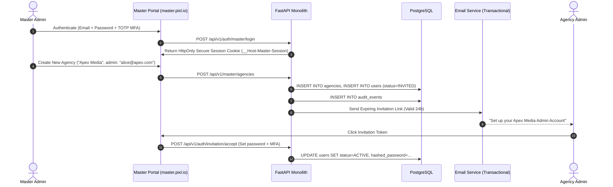
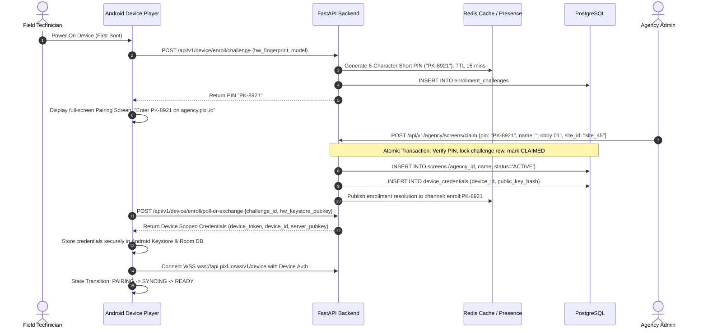
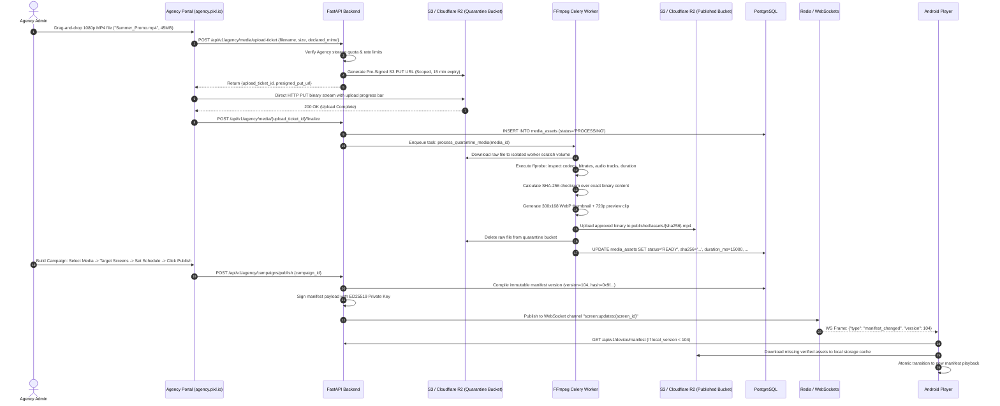
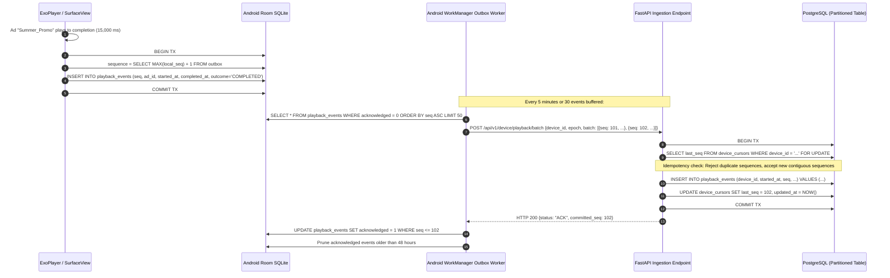

# PIXL 2.0: User Journeys & Operational Workflows

> **Status: planning only.** These sequences are illustrative, not final API contracts. Master-authorized assignment must precede Agency pairing; unrestricted Agency self-claim is superseded. Enrollment possession checks and durable sequence allocation are required by [document 18](18_SECURITY_AND_PROTOCOL_IMPLEMENTATION_PREREQUISITES.md). See [document 15](15_MEDIA_AND_CAMPAIGN_WORKFLOW_SPEC.md) for the simplified media-to-campaign flow.

## 1. Journey 1: Master Admin Provisions Agency & Oversees Device

---

## 2. Journey 2: Device Enrollment, Claiming, and Activation

---

## 3. Journey 3: Agency Media Upload, Approval & Campaign Publishing

---

## 4. Journey 4: Proof-of-Play Local Outbox & Server Ingestion

