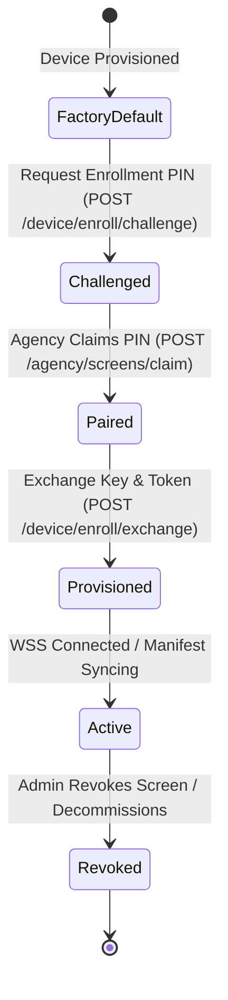

# PIXL 2.0: Threat Model & Security Architecture (STRIDE)

> **Status: planning only.** Controls below are proposed, not verified. Bearer tokens and cursors alone do not provide signed PoP attribution or proof of physical display. Enrollment, replay protection, signing trust, session isolation and archive immutability require the contracts in [document 18](18_SECURITY_AND_PROTOCOL_IMPLEMENTATION_PREREQUISITES.md).

## 1. STRIDE Analysis & Defensive Countermeasures

| Threat (STRIDE) | Attack Vector / Scenario | Impact | Defense & Architectural Control |
| :--- | :--- | :--- | :--- |
| **S - Spoofing** | Attacker extracts hardcoded secrets or sniffs network to impersonate legitimate screen hardware. | Fraudulent proof-of-play events injected; false ad billing. | **Hardware-bound Keystore**: Android Keystore generates private key inside TEE/StrongBox. Device token generated upon pairing exchange; requests require HMAC or token authentication. |
| **S - Spoofing** | Brute-forcing 6-digit screen pairing PINs to hijack unassigned screens. | Rogue tenant gains control of victim screen. | **PIN Collision & Abuse Protection**: PINs are 6 alphanumeric characters (~1.68B combinations) with 15-minute TTL, single-use, max 5 failed claim attempts per IP/minute with progressive lockout. PINs are atomic-locked via DB row locks. |
| **T - Tampering** | Attacker intercepts or replays network traffic to alter screen manifest or redirect playback to malicious URLs. | Defacement, objectionable content broadcast in public spaces. | **Cryptographically Signed Manifests**: Manifests signed with ED25519 private key on server. Android player verifies signature with bundled public key before executing schedule. |
| **T - Tampering** | User uploads malicious polyglot file (e.g. executable wrapped in MP4). | Remote code execution on backend worker or player. | **Quarantine Pipeline**: Uploads go directly to isolated private S3 quarantine. FFmpeg runs in sandboxed, non-root, resource-constrained containers. Strict MIME sniffing + magic bytes validation. |
| **R - Repudiation** | Advertiser claims ads were never shown, or Agency claims 10,000 screens played 100% of impressions. | Billing disputes, fraud, lost customer trust. | **Monotonic Ingestion & Cryptographic PoP**: Android client maintains local append-only SQLite outbox with sequential IDs and timestamps. Server locks ingestion cursor atomically. Raw logs archived to immutable WORM S3 buckets. |
| **I - Information Disclosure** | Tenant A attempts to view Tenant B's screens, media, or campaign revenues by guessing IDs. | Breach of client confidentiality, competitor intelligence leak. | **Enforced Tenant Filtering & PostgreSQL RLS**: Tenant context extracted from cryptographically verified session. All queries bind `agency_id`. Negative tests verify `404 Not Found` across tenant boundaries. |
| **D - Denial of Service** | 10,000 screens reconnect simultaneously after power restoration or network outage ("Thundering Herd"). | API gateway overload, database connection exhaustion, platform outage. | **Full Jitter & Exponential Backoff**: Devices use decorrelated jittered backoff on reconnect. Static assets served via Cloudflare CDN with cache headers. Connection draining & rate limiting at Traefik/Nginx layer. |
| **E - Elevation of Privilege** | Agency Admin attempts to modify master platform configuration or claim other tenants' devices. | Compromise of master infrastructure and other agencies. | **Zero Public Signup & Role Boundaries**: No public user registration. Strict role authorization in FastAPI dependencies (`require_role("master_admin")`). Separate session cookies per domain. |

---

## 2. Password & Credential Security Standards
- **Password Hashing**: **Argon2id** (`time_cost=3`, `memory_cost=65536` KiB (64 MB), `parallelism=4`).
- **Session Tokens**: Cryptographically secure 256-bit random tokens (32 bytes entropy) stored in Redis with 14-day sliding expiration.
- **Master Admin 2FA**: Mandatory TOTP (RFC 6238) using HMAC-SHA1 or HMAC-SHA256. Backup recovery codes hashed with Argon2id.
- **Account Lockout**: 5 consecutive failed login attempts trigger a 15-minute lockout and email security alert.

---

## 3. Device Cryptographic Lifecycle

- **Key Generation**: Upon enrollment, the Android app requests Android Keystore to generate an asymmetric key pair inside hardware-backed storage (StrongBox Keymaster if available).
- **Revocation**: Master or Agency Admin can instantly revoke screen credentials via the dashboard. The `device_credentials` table sets `revoked_at = NOW()`, and the device ID is pushed to Redis revocation blacklist, disconnecting the WebSocket connection immediately.

