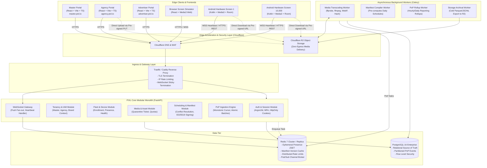

# PIXL 2.0: System Architecture & Technical Topography

> **Status: planning only.** This is a target architecture, not deployed infrastructure. Durable dispatch, cache/broker failure boundaries and deployment security must follow [document 18](18_SECURITY_AND_PROTOCOL_IMPLEMENTATION_PREREQUISITES.md). User-visible workflows and kiosk behavior are specified in documents 14–16.

## 1. High-Level Modular Monolith Architecture

PIXL 2.0 avoids premature microservice fragmentation. It is built as a high-performance **Modular Monolith** using Python (FastAPI + SQLAlchemy 2 + Asyncpg) paired with Celery asynchronous background workers and persistent caching/presence via Redis 7 and PostgreSQL 16.

---

## 2. Component Boundaries & Isolation

### A. FastAPI Modular Monolith
The backend codebase is organized into bounded modules with strict isolation:
- `app/modules/auth`: Session management, Argon2id verification, TOTP MFA, cookie handling.
- `app/modules/tenancy`: Agency & Brand hierarchy, invitation token redemption, tenant switching.
- `app/modules/fleet`: Screen registration, 6-character pairing PIN lifecycle, telemetry ingest, presence tracking.
- `app/modules/media`: Pre-signed quarantine upload authorization, asset verification, metadata persistence.
- `app/modules/scheduling`: Zone layout resolution, priority arbitration, ED25519 manifest signing.
- `app/modules/ingestion`: Monotonic sequence validator, device cursor locks, bulk proof-of-play writer.
- `app/modules/reporting`: Hourly rollup generation, advertiser audit exports.

### B. Worker Pools (Celery with Redis Broker)
- **Quarantine Media Pool**: Resource-capped worker containers with FFmpeg installed. Strictly limited CPU/memory limits (`--cpus=2 --memory=2g`) to prevent CPU starvation of the web API during video transcoding.
- **Reporting & Archival Pool**: Long-running read-heavy database aggregation jobs, isolated from the synchronous API request pool.

### C. Android Display Client
- Native Kotlin application built with **AndroidX Media3 (ExoPlayer)** for video decode and hardware surface rendering.
- **Room SQLite** for offline manifest persistence and durable outbox buffer.
- **WorkManager** with network constraints (`NetworkType.CONNECTED`) for reliable background telemetry synchronization.
- **Android Keystore** for cryptographic storage of the device private key.

### D. Browser Screen Simulator
- React/TypeScript application rendering scheduled playlists in standard browser viewports (16:9, 9:16).
- Implements the exact same manifest schema and state machine as the Android player for local agency testing.
- Clearly flags that browser fullscreen is not equivalent to Android Kiosk / Lock Task Mode.

