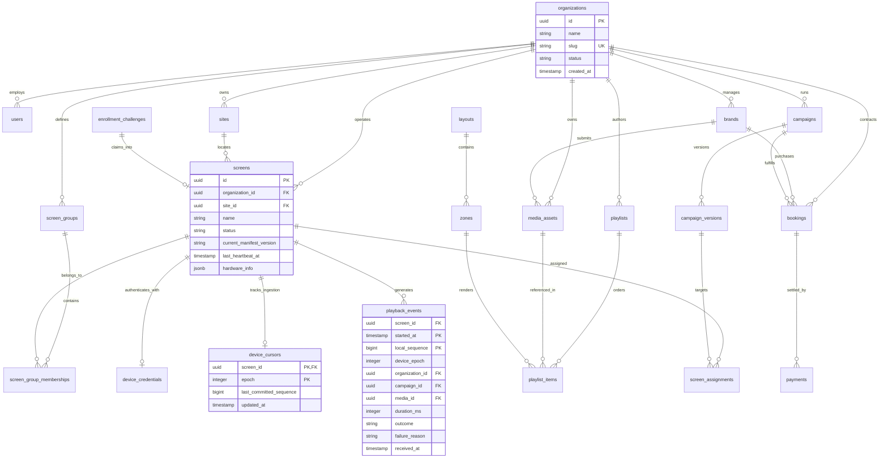

# PIXL 2.0: Database ERD & Schema Design

> **Status: planning only.** DDL below is a partial illustrative design, not an executable migration set. It omits required entities, tenant ownership constraints, RLS policies and epoch-safe event identity. [Document 18](18_SECURITY_AND_PROTOCOL_IMPLEMENTATION_PREREQUISITES.md) defines mandatory corrections before implementation.

## 1. Entity-Relationship Diagram (Mermaid)



---

## 2. Core Relational Tables & DDL Architecture

### A. Tenancy & Fleet Entities
```sql
CREATE TABLE organizations (
    id UUID PRIMARY KEY DEFAULT gen_random_uuid(),
    name VARCHAR(255) NOT NULL,
    slug VARCHAR(100) NOT NULL UNIQUE,
    status VARCHAR(50) NOT NULL DEFAULT 'ACTIVE', -- ACTIVE, SUSPENDED, DELETED
    max_screens INT NOT NULL DEFAULT 100,
    storage_quota_bytes BIGINT NOT NULL DEFAULT 53687091200, -- 50 GB default
    created_at TIMESTAMPTZ NOT NULL DEFAULT NOW(),
    updated_at TIMESTAMPTZ NOT NULL DEFAULT NOW()
);

CREATE TABLE sites (
    id UUID PRIMARY KEY DEFAULT gen_random_uuid(),
    organization_id UUID NOT NULL REFERENCES organizations(id) ON DELETE CASCADE,
    name VARCHAR(255) NOT NULL,
    timezone VARCHAR(100) NOT NULL DEFAULT 'UTC',
    address TEXT,
    created_at TIMESTAMPTZ NOT NULL DEFAULT NOW()
);

CREATE INDEX idx_sites_org ON sites(organization_id);

CREATE TABLE screens (
    id UUID PRIMARY KEY DEFAULT gen_random_uuid(),
    organization_id UUID NOT NULL REFERENCES organizations(id) ON DELETE CASCADE,
    site_id UUID REFERENCES sites(id) ON DELETE SET NULL,
    name VARCHAR(255) NOT NULL,
    status VARCHAR(50) NOT NULL DEFAULT 'UNREGISTERED', -- UNREGISTERED, PAIRING, SYNCING, READY, PLAYING, OFFLINE, REVOKED
    orientation VARCHAR(20) NOT NULL DEFAULT 'LANDSCAPE', -- LANDSCAPE, PORTRAIT
    resolution VARCHAR(20) NOT NULL DEFAULT '1920x1080',
    current_manifest_version INT NOT NULL DEFAULT 0,
    last_heartbeat_at TIMESTAMPTZ,
    last_sync_at TIMESTAMPTZ,
    app_version VARCHAR(50),
    os_version VARCHAR(50),
    storage_free_bytes BIGINT,
    created_at TIMESTAMPTZ NOT NULL DEFAULT NOW(),
    updated_at TIMESTAMPTZ NOT NULL DEFAULT NOW()
);

CREATE INDEX idx_screens_org ON screens(organization_id);
CREATE INDEX idx_screens_heartbeat ON screens(last_heartbeat_at);
```

### B. Device Credentials & Ingestion Cursors
```sql
CREATE TABLE enrollment_challenges (
    id UUID PRIMARY KEY DEFAULT gen_random_uuid(),
    pin VARCHAR(8) NOT NULL UNIQUE,
    hw_fingerprint VARCHAR(255) NOT NULL,
    status VARCHAR(50) NOT NULL DEFAULT 'PENDING', -- PENDING, CLAIMED, EXPIRED
    organization_id UUID REFERENCES organizations(id) ON DELETE CASCADE,
    screen_id UUID REFERENCES screens(id) ON DELETE CASCADE,
    expires_at TIMESTAMPTZ NOT NULL,
    attempts INT NOT NULL DEFAULT 0,
    created_at TIMESTAMPTZ NOT NULL DEFAULT NOW()
);

CREATE INDEX idx_enroll_pin ON enrollment_challenges(pin) WHERE status = 'PENDING';

CREATE TABLE device_credentials (
    screen_id UUID PRIMARY KEY REFERENCES screens(id) ON DELETE CASCADE,
    key_id VARCHAR(64) NOT NULL UNIQUE,
    public_key_pem TEXT NOT NULL,
    token_hash VARCHAR(255) NOT NULL,
    revoked_at TIMESTAMPTZ,
    created_at TIMESTAMPTZ NOT NULL DEFAULT NOW()
);

CREATE TABLE device_cursors (
    screen_id UUID NOT NULL REFERENCES screens(id) ON DELETE CASCADE,
    epoch INT NOT NULL DEFAULT 1,
    last_committed_sequence BIGINT NOT NULL DEFAULT 0,
    updated_at TIMESTAMPTZ NOT NULL DEFAULT NOW(),
    PRIMARY KEY (screen_id, epoch)
);
```

### C. Media Assets & Playlists
```sql
CREATE TABLE media_assets (
    id UUID PRIMARY KEY DEFAULT gen_random_uuid(),
    organization_id UUID NOT NULL REFERENCES organizations(id) ON DELETE CASCADE,
    brand_id UUID REFERENCES brands(id) ON DELETE SET NULL,
    filename VARCHAR(255) NOT NULL,
    storage_key VARCHAR(512) NOT NULL UNIQUE,
    sha256 VARCHAR(64) NOT NULL,
    mime_type VARCHAR(100) NOT NULL,
    size_bytes BIGINT NOT NULL,
    duration_ms INT NOT NULL DEFAULT 0, -- 0 for images
    width INT NOT NULL,
    height INT NOT NULL,
    status VARCHAR(50) NOT NULL DEFAULT 'PROCESSING', -- PROCESSING, READY, FAILED, QUARANTINED
    processing_error TEXT,
    thumbnail_url TEXT,
    created_at TIMESTAMPTZ NOT NULL DEFAULT NOW()
);

CREATE INDEX idx_media_org ON media_assets(organization_id);
CREATE INDEX idx_media_hash ON media_assets(sha256);

CREATE TABLE playlists (
    id UUID PRIMARY KEY DEFAULT gen_random_uuid(),
    organization_id UUID NOT NULL REFERENCES organizations(id) ON DELETE CASCADE,
    name VARCHAR(255) NOT NULL,
    is_reusable BOOLEAN NOT NULL DEFAULT TRUE,
    created_at TIMESTAMPTZ NOT NULL DEFAULT NOW(),
    updated_at TIMESTAMPTZ NOT NULL DEFAULT NOW()
);

CREATE TABLE playlist_items (
    id UUID PRIMARY KEY DEFAULT gen_random_uuid(),
    playlist_id UUID NOT NULL REFERENCES playlists(id) ON DELETE CASCADE,
    media_id UUID NOT NULL REFERENCES media_assets(id) ON DELETE RESTRICT,
    sort_order INT NOT NULL,
    duration_mode VARCHAR(50) NOT NULL DEFAULT 'FULL_CLIP', -- FULL_CLIP, CUSTOM_DURATION, IMAGE_DEFAULT
    configured_duration_ms INT NOT NULL DEFAULT 10000,
    created_at TIMESTAMPTZ NOT NULL DEFAULT NOW(),
    CONSTRAINT uq_playlist_order UNIQUE (playlist_id, sort_order)
);
```

### D. Campaigns & Screen Assignments
```sql
CREATE TABLE campaigns (
    id UUID PRIMARY KEY DEFAULT gen_random_uuid(),
    organization_id UUID NOT NULL REFERENCES organizations(id) ON DELETE CASCADE,
    brand_id UUID REFERENCES brands(id) ON DELETE SET NULL,
    name VARCHAR(255) NOT NULL,
    status VARCHAR(50) NOT NULL DEFAULT 'DRAFT', -- DRAFT, APPROVED, PUBLISHED, ARCHIVED
    priority INT NOT NULL DEFAULT 100, -- 1000=EMERGENCY, 500=SPONSORSHIP, 100=COMMERCIAL, 10=FILLER
    start_time TIMESTAMPTZ NOT NULL,
    end_time TIMESTAMPTZ NOT NULL,
    current_version INT NOT NULL DEFAULT 1,
    created_at TIMESTAMPTZ NOT NULL DEFAULT NOW()
);

CREATE TABLE screen_assignments (
    id UUID PRIMARY KEY DEFAULT gen_random_uuid(),
    campaign_id UUID NOT NULL REFERENCES campaigns(id) ON DELETE CASCADE,
    screen_id UUID REFERENCES screens(id) ON DELETE CASCADE,
    screen_group_id UUID REFERENCES screen_groups(id) ON DELETE CASCADE,
    created_at TIMESTAMPTZ NOT NULL DEFAULT NOW(),
    CONSTRAINT chk_target_present CHECK (screen_id IS NOT NULL OR screen_group_id IS NOT NULL)
);
```

### E. Proof-of-Play Partitioned Table (Time Partitioning)
PostgreSQL handles 86.4M events/day via declarative range partitioning on `started_at` (weekly partitions):
```sql
CREATE TABLE playback_events (
    screen_id UUID NOT NULL,
    device_epoch INT NOT NULL,
    local_sequence BIGINT NOT NULL,
    started_at TIMESTAMPTZ NOT NULL,
    organization_id UUID NOT NULL,
    campaign_id UUID,
    media_id UUID NOT NULL,
    duration_ms INT NOT NULL,
    outcome VARCHAR(30) NOT NULL, -- COMPLETED, INTERRUPTED, DECODE_FAILED, SKIPPED
    failure_reason TEXT,
    received_at TIMESTAMPTZ NOT NULL DEFAULT NOW(),
    PRIMARY KEY (started_at, screen_id, local_sequence)
) PARTITION BY RANGE (started_at);

-- Example weekly partition:
CREATE TABLE playback_events_y2026w44 PARTITION OF playback_events
    FOR VALUES FROM ('2026-10-26 00:00:00+00') TO ('2026-11-02 00:00:00+00');

CREATE INDEX idx_pop_device_seq ON playback_events(screen_id, local_sequence);
CREATE INDEX idx_pop_campaign ON playback_events(campaign_id, started_at);
CREATE INDEX idx_pop_org_started ON playback_events(organization_id, started_at);
```

