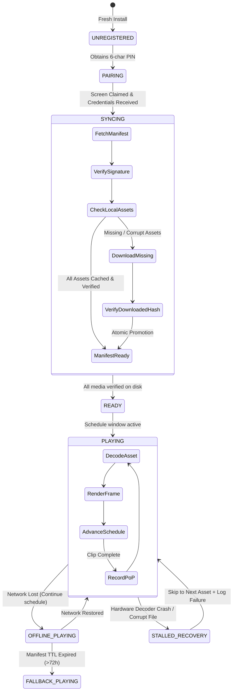

# PIXL 2.0: Offline Synchronization & Playback Engine Specification

> **Status: planning only.** Offline reliability is not yet implemented or tested. Manifest expiry applies online and offline; validity is measured from issuance, not disconnection. Cache policy and recovery details are refined in [document 16](16_ANDROID_KIOSK_AND_DEVICE_RELIABILITY_SPEC.md); cryptographic and durable cursor rules are in [document 18](18_SECURITY_AND_PROTOCOL_IMPLEMENTATION_PREREQUISITES.md).

## 1. Controlled Playback State Machine

The Android player runs an isolated deterministic playback state machine for each display zone:



---

## 2. Media Download & Local Cache Verification Algorithm

Devices must **never** play partially downloaded or unverified files. Assets are downloaded to isolated temporary files and promoted atomically:

```text
Algorithm DownloadAndPromoteAsset(asset_metadata):
  target_file = "/data/data/io.pixl.player/cache/" + asset_metadata.sha256 + ".mp4"
  temp_file = target_file + ".download." + UUID()

  if FileExists(target_file):
    if VerifySha256(target_file) == asset_metadata.sha256:
      MarkAssetAsActive(asset_metadata.sha256)
      return SUCCESS

  EnforceDiskQuota(required_bytes = asset_metadata.size_bytes)

  download_stream = HTTP_GET(asset_metadata.download_url)
  hasher = SHA256_Hasher()

  open temp_file for writing:
    while chunk = download_stream.read(64KB):
      hasher.update(chunk)
      temp_file.write(chunk)

  if hasher.digest() != asset_metadata.sha256:
    DeleteFile(temp_file)
    throw CorruptMediaException("Hash mismatch: expected " + asset_metadata.sha256)

  // Atomic file rename on POSIX/Android filesystem:
  AtomicRename(temp_file, target_file)
  MarkAssetAsActive(asset_metadata.sha256)
  return SUCCESS
```

---

## 3. Disk Space Management & LRU Eviction Policy
1. **Quota Ceiling**: The local media cache has a provisional maximum of **16 GiB**, constrained further by device capacity and a **2 GiB free-space reserve**. Durable event storage has a separate budget. See document 16 for cache admission and pinned-asset overflow behavior.
2. **Pinned Assets**: All assets included in the currently active manifest and the next scheduled 24-hour window are marked as **PINNED** and are immune to eviction.
3. **Eviction Order**: When free space drops below 2 GB or the quota ceiling is reached, unpinned assets are evicted in **Least Recently Played (LRP)** order.
4. **Fallback Asset Protection**: Branded standby emergency assets (`asset_default_fallback.*`) are permanently pinned and can never be evicted.

---

## 4. Cryptographic Manifest Verification & Offline Expiry
1. **Server Signing**: The compiled JSON payload is signed by the backend using an **ED25519** private key. The base64 signature is delivered in the `signature` wrapper.
2. **Device Verification**: The Android app verifies the payload bytes using the server public key installed during device enrollment or compiled into the APK.
3. **Offline Expiry Boundary**:
   - Every manifest contains `valid_from` and `valid_until` ISO8601 timestamps (maximum validity: 72 hours).
   - If trusted time exceeds `valid_until`, whether online or offline, the player logs an `OFFLINE_EXPIRED` event and gracefully drops to the fallback standby loop.
   - **Trade-off Acknowledgment**: A disconnected device cannot receive immediate remote revocation. The 72-hour boundary provides the optimal balance between high availability in intermittent connectivity and business risk protection.

